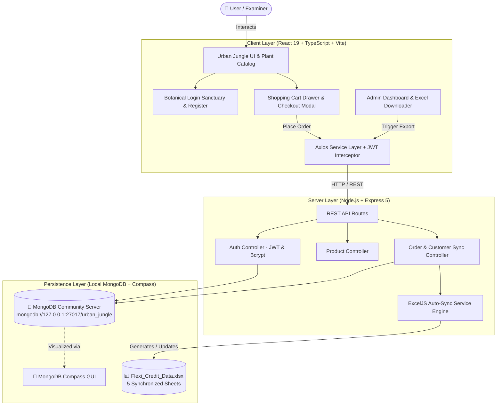
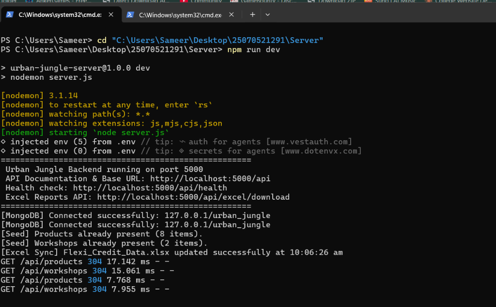
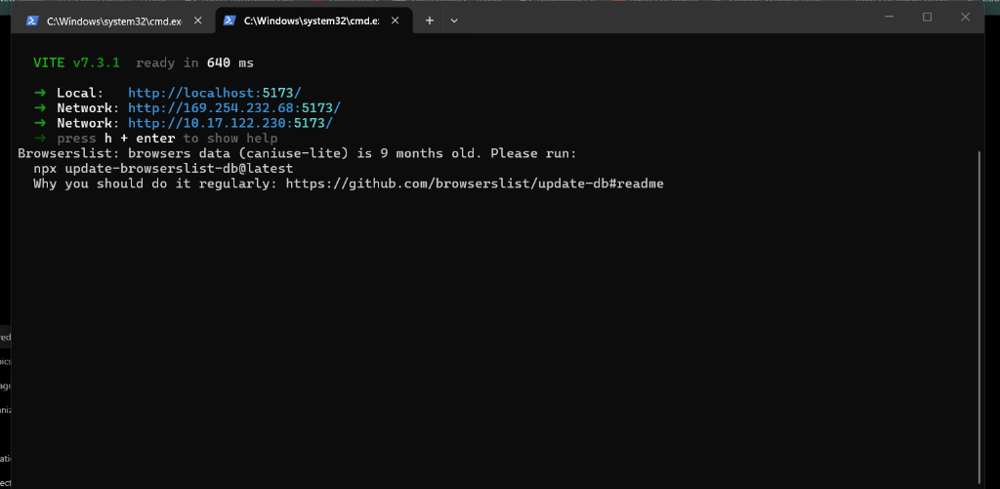
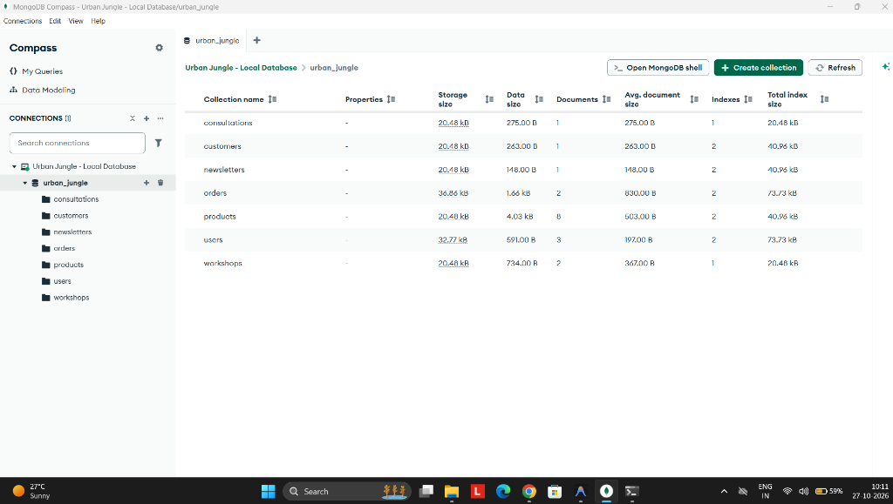

# 🌿 Urban Jungle — Full-Stack Plant E-Commerce Website

<div align="center">


[](https://react.dev/)
[](https://www.typescriptlang.org/)
[](https://developer.mozilla.org/en-US/docs/Web/JavaScript)
[](https://nodejs.org/)
[](https://expressjs.com/)
[](https://www.mongodb.com/)
[](https://www.mongodb.com/products/compass)
[](https://25070521291-ca-03-one.vercel.app/)


**A modern, production-grade Full-Stack E-Commerce platform for botanical plants and gardening services.**  
Designed and engineered for seamless plant discovery, secure JWT authentication, multi-step checkout, real-time MongoDB database persistence, and automated ExcelJS multi-sheet data reporting.

[🚀 **Open Live Web App on Vercel**](https://25070521291-ca-03-one.vercel.app/) • [🌐 Local Frontend (Port 5173)](http://localhost:5173) • [📡 Backend API (Port 5000)](http://localhost:5000/api) • [📊 Download Excel Data](http://localhost:5000/api/excel/download)

</div>

---

## 📌 Project Information

- **Project Name:** Urban Jungle — Full-Stack Plant E-Commerce Website
- **Course Component:** Continuous Assessment (CA) — Flexi Credit Project
- **Student PRN:** `25070521291`
- **GitHub Repository:** [`Sameerkaradbhajne/25070521291-CA-03`](https://github.com/Sameerkaradbhajne/25070521291-CA-03)
- **Architecture:** Client-Server decoupled full-stack architecture (`Client/` + `Server/`)
- **Database:** Local MongoDB Community Server + MongoDB Compass Integration (`urban_jungle`)

---

## 📖 Project Overview

**Urban Jungle** is an elegant, full-stack e-commerce web platform created to deliver an exceptional online shopping experience for indoor botanical plants, plant care services, and community workshops. 

The application is built on a clean, decoupled architecture:
1. **Frontend Client (`Client/`):** Built with React 19, TypeScript, Vite, and TailwindCSS, providing a high-performance, responsive user interface with rich animations (Framer Motion), interactive botanical quiz, cart drawer, and a dedicated login sanctuary.
2. **Backend Server (`Server/`):** Powered by Node.js and Express 5, implementing RESTful API endpoints for catalog management, order processing, service bookings, user authentication with bcrypt and JWT, and automated Excel synchronization.
3. **Database Tier:** Utilizes MongoDB Community Server with Mongoose schemas and MongoDB Compass GUI management for transparent visual database inspection.
4. **Data Reporting Layer:** Generates and maintains a synchronized 5-worksheet Excel workbook (`Flexi_Credit_Data.xlsx`) through ExcelJS.

---

## 🌟 Key Features

### 🌿 Plant Catalog & Shopping Experience
- **Dynamic Botanical Catalog:** Fetches live product data from MongoDB with filtering by light/care requirements and search capability.
- **Product Detail Modals:** Displays detailed specifications, watering frequency, sunlight needs, humidity guidelines, and toxicity badges.
- **Interactive Plant Match Quiz:** Guides users to their ideal plant match based on room lighting, pet friendliness, and care commitment.

### 🔐 Authentication & Sanctuary Login
- **Urban Jungle Botanical Sanctuary Login:** Custom aesthetic login and registration interface featuring branded botanical imagery, fluid transitions, and responsive typography.
- **Secure Password Hashing:** User passwords hashed using `bcryptjs` with salt round 10 before saving.
- **Role-Based Authorization:** Secure separation between customer and administrator accounts, protecting management routes and sensitive data.

### 🛒 Cart & Checkout Management
- **Interactive Slide-over Cart Drawer:** Real-time quantity adjustments, price calculations, and subtotal summaries.
- **Multi-Step Checkout Flow:** Captures customer contact information, delivery address, and payment method with order validation.
- **Persistent Order Generation:** Orders are assigned unique numbers (`UJ-XXXXXX`), stored in MongoDB, and mirrored into Excel.

### 🩺 Plant Services & Community Workshops
- **Service Consultations:** Booking flow for Interior Styling, The Plant Doctor, and Repotting Station services.
- **Interactive Workshops:** Community workshop RSVP and ticket reservation with MongoDB persistence.
- **Newsletter Subscription:** Direct email signup endpoint recorded in database.

### 📊 Admin Dashboard & Automated Excel Reporting
- **Orders & Operations Modal:** Integrated administrative dashboard accessible directly from navigation.
- **Live Excel Synchronization:** Every placed order, product update, or status change automatically writes to `Flexi_Credit_Data.xlsx`.
- **Custom Multi-Sheet Export:** Direct download of individual sheets or the entire workbook with auto-filters and frozen header panes.

---

## 🏛️ Application Architecture



---

## 🛠️ Technology Stack

| Layer | Technology | Purpose & Version |
| :--- | :--- | :--- |
| **Frontend** | React 19 (`^19.2.0`) | Modern UI component rendering |
| | TypeScript (`~5.9.3`) | Strong type safety across components and models |
| | Vite 7 (`^7.2.4`) | High-speed frontend development server and bundler |
| | TailwindCSS (`^3.4.17`) | Utility-first styling with custom botanical palette |
| | Framer Motion (`^12.29.2`) | Smooth animations, page reveals, and modal transitions |
| | Lucide React (`^0.563.0`) | Clean, modern iconography |
| | Axios (`^1.20.0`) | Promise-based HTTP client with JWT interceptor |
| **Backend** | Node.js (v18+) | Server-side JavaScript runtime environment |
| | Express.js 5 (`^5.2.1`) | High-performance RESTful API routing and middleware |
| | Mongoose 9 (`^9.3.0`) | Elegant MongoDB object modeling and schema validation |
| | BcryptJS (`^3.0.3`) | Cryptographic salt-based password hashing |
| | JSONWebToken (`^9.0.3`) | Token generation and route verification |
| | CORS (`^2.8.5`) | Cross-Origin Resource Sharing control |
| | Dotenv (`^17.3.1`) | Environment variable configuration management |
| **Database** | MongoDB Community Server (v9.0) | Local NoSQL document database (`127.0.0.1:27017`) |
| | MongoDB Compass (v1.53+) | Visual database management and query interface |
| **Reporting** | ExcelJS (`^4.4.0`) | Automated multi-sheet workbook generation and styling |

---

## 📁 Project Folder Structure

```
25070521291/
├── Client/                             # React + TypeScript Frontend
│   ├── public/
│   │   ├── images/                     # Botanical photography & screenshots
│   │   └── vite.svg
│   ├── src/
│   │   ├── components/
│   │   │   ├── Navbar.tsx              # Navigation bar with Cart, Orders & Login links
│   │   │   ├── Hero.tsx                # Hero section with CTA & quiz launch
│   │   │   ├── Features.tsx            # Guarantee, delivery, and care badges
│   │   │   ├── ProductShowcase.tsx     # Dynamic catalog queried from /api/products
│   │   │   ├── Services.tsx            # Consultations (Styling, Plant Doctor, Repotting)
│   │   │   ├── Workshops.tsx           # Community events & RSVP registration
│   │   │   ├── Testimonials.tsx        # Customer reviews
│   │   │   ├── CartDrawer.tsx          # Interactive cart with quantity controls
│   │   │   ├── CheckoutModal.tsx       # Multi-step checkout with address & payment
│   │   │   ├── OrdersModal.tsx         # Admin Dashboard with order records & Excel tools
│   │   │   ├── LoginPage.tsx           # Premium Urban Jungle Login Sanctuary
│   │   │   ├── Quiz.tsx                # Plant Match Quiz modal
│   │   │   └── Footer.tsx              # Newsletter subscription and site links
│   │   ├── context/
│   │   │   └── AuthContext.tsx         # Global authentication state provider
│   │   ├── services/
│   │   │   └── api.ts                  # Centralized Axios API service layer
│   │   ├── App.tsx                     # Main layout & route state management
│   │   ├── index.css                   # Global styling and Tailwind directives
│   │   └── main.tsx                    # React DOM entry point
│   ├── package.json                    # Frontend dependencies & scripts
│   ├── tsconfig.json                   # TypeScript configuration
│   └── vite.config.ts                  # Vite build configuration
├── Server/                             # Node.js + Express Backend
│   ├── config/
│   │   └── db.js                       # Mongoose database connection configuration
│   ├── controllers/
│   │   ├── authController.js           # Login, registration & JWT issuance
│   │   ├── productController.js        # Product queries, search & category filtering
│   │   ├── orderController.js          # Order placement, customer upsert & Excel sync
│   │   ├── consultationController.js   # Service consultation booking
│   │   ├── workshopController.js       # Workshop registration & attendee tracking
│   │   ├── newsletterController.js     # Newsletter subscription handling
│   │   └── excelController.js          # Excel report downloads & manual sync
│   ├── middleware/
│   │   ├── authMiddleware.js           # JWT verification middleware
│   │   └── errorHandler.js             # Global centralized error handler
│   ├── models/
│   │   ├── User.js                     # User schema with bcrypt password hashing
│   │   ├── Product.js                  # Product catalog schema
│   │   ├── Order.js                    # Order schema with shipping & payment details
│   │   ├── Customer.js                 # Customer schema with aggregated order metrics
│   │   ├── Consultation.js             # Plant consultation booking schema
│   │   ├── Workshop.js                 # Workshop event schema
│   │   └── Newsletter.js               # Newsletter subscriber schema
│   ├── routes/
│   │   ├── authRoutes.js               # /api/auth endpoints
│   │   ├── productRoutes.js            # /api/products endpoints
│   │   ├── orderRoutes.js              # /api/orders endpoints
│   │   ├── consultationRoutes.js       # /api/consultations endpoints
│   │   ├── workshopRoutes.js           # /api/workshops endpoints
│   │   ├── newsletterRoutes.js         # /api/newsletter endpoints
│   │   └── excelRoutes.js              # /api/excel endpoints
│   ├── services/
│   │   └── excelService.js             # ExcelJS 5-sheet workbook generation engine
│   ├── seed/
│   │   └── seedData.js                 # Database populator script
│   ├── Flexi_Credit_Data.xlsx          # Live synchronized Excel workbook
│   ├── .env.example                    # Template environment variables
│   ├── package.json                    # Server dependencies & scripts
│   └── server.js                       # Express application entry point
├── Flexi_Credit_Data.xlsx              # Root synchronized Excel workbook copy
├── .gitignore                          # Excludes node_modules, credentials & caches
└── README.md                           # Project documentation & evaluation guide
```

---

## 🚀 Installation & Running Locally

### Prerequisites
- **Node.js** (v18.0.0 or higher)
- **MongoDB Community Server** (v7.0 or higher) installed and running locally
- **MongoDB Compass** (for visual database browsing)

---

### Step 1: Clone the Repository
Clone the project repository to your local environment:
```bash
git clone https://github.com/Sameerkaradbhajne/25070521291-CA-03.git
cd 25070521291
```

---

### Step 2: Install Dependencies
Install dependencies for both the decoupled frontend client and backend server:

#### 1. Frontend Client Dependencies (`Client/`):
```bash
cd Client
npm install
```

#### 2. Backend Server Dependencies (`Server/`):
```bash
cd Server
npm install
```

---

### Step 3: Configure Environment Variables (`Server/.env`)
Create a `.env` file in the backend `Server/` directory (`Server/.env`):

```env
PORT=5000
MONGODB_URI=mongodb://127.0.0.1:27017/urban_jungle
NODE_ENV=development
JWT_SECRET=replace_with_your_own_secure_secret
CLIENT_URL=http://localhost:5173
```

> **Security Note:** The MongoDB database name is `urban_jungle`. The actual `Server/.env` file is excluded from Git tracking via `.gitignore` to protect all local secrets and environment keys. Never commit real credentials or production secrets.

---

### Step 4: Start MongoDB Community Server
Ensure MongoDB Community Server is installed and actively running on port `27017`:
```powershell
# Verify MongoDB service status on Windows:
Get-Service MongoDB
```

---

### Step 5: Start Backend Server (`Server/`)
In your first terminal, start the Express backend API server:

```bash
cd Server
npm run dev
```
*(Alternatively, use `npm start` for standard node execution, or `npm run seed` to populate initial catalog data)*

- **Backend API Base URL:** `http://localhost:5000`
- **Health Check Endpoint:** `http://localhost:5000/api/health`
- **Excel Report Download:** `http://localhost:5000/api/excel/download`



---

### Step 6: Start Frontend Client (`Client/`)
In a second terminal, start the Vite development server:

```bash
cd Client
npm run dev
```

- **Frontend Application URL:** `http://localhost:5173`



---

### Step 7: Open Application in Browser
Navigate to **[http://localhost:5173](http://localhost:5173)** to access the Urban Jungle store.

---

## 🍃 MongoDB Setup & Compass Integration

### Connection Details
- **Connection URI:** `mongodb://127.0.0.1:27017/urban_jungle`
- **Host:** `127.0.0.1` (or `localhost`)
- **Port:** `27017`
- **Database Name:** `urban_jungle`

### Connecting with MongoDB Compass:
1. Open **MongoDB Compass**.
2. In the **New Connection** field, enter:
   ```
   mongodb://127.0.0.1:27017/
   ```
3. Click **Connect**.
4. Select the **`urban_jungle`** database from the list to view all collections.



### Database Collections in `urban_jungle`:
| Collection | Description | Primary Fields |
| :--- | :--- | :--- |
| **`products`** | Botanical inventory catalog | `name`, `price`, `category`, `image`, `description`, `care`, `stock` |
| **`orders`** | Customer purchases | `orderNumber`, `customer`, `items`, `total`, `payment`, `status` |
| **`customers`** | Customer transaction records | `customerId`, `name`, `email`, `totalOrders`, `totalSpent` |
| **`users`** | Registered user and admin accounts | `name`, `email`, `password` (bcrypt hashed), `role` |
| **`workshops`** | Community gardening workshops | `title`, `instructor`, `date`, `price`, `attendees` |
| **`consultations`** | Plant doctor & styling bookings | `serviceType`, `clientName`, `email`, `phone`, `status` |
| **`newsletters`** | Subscriber mailing list | `email`, `subscribedAt` |

---

## 🔐 Authentication & Security

- **Password Hashing:** Passwords are never stored in plaintext. Mongoose pre-save middleware invokes `bcryptjs` with salt round `10`.
- **JWT Tokens:** Issued upon successful authentication (`/api/auth/login` or `/api/auth/register`) with an expiration period.
- **Request Interceptor:** Axios automatically attaches the bearer token from `localStorage` (`urban_token`) via HTTP `Authorization: Bearer <token>`.
- **Admin Authorization:** Protected endpoints (`/api/orders`, `/api/excel/*`) require validated administrator JWT tokens. Non-admin users are strictly denied with HTTP 403 Forbidden.
- **Zero-Bypass Security:** Full database and password verification enforced across all routes with zero in-memory or fallback bypasses.

---

## 📊 Automated Excel Reporting (`Flexi_Credit_Data.xlsx`)

The backend contains an automated Excel engine powered by **ExcelJS** that generates and synchronizes `Flexi_Credit_Data.xlsx` in real-time.

### 5 Synchronized Worksheets:
1. **`Orders` Sheet:** Complete order log with Order ID, customer details, individual item rows, subtotal, tax, shipping, and order status.
2. **`Customers` Sheet:** Aggregated metrics per customer including total lifetime orders, total spend, and most recent order timestamp.
3. **`Products` Sheet:** Complete plant inventory with scientific names, pricing, categories, and stock availability.
4. **`Payments` Sheet:** Secure payment records featuring masked card numbers (`•••• 1234`), transaction IDs, payment methods, and amounts.
5. **`Order Status History` Sheet:** Complete audit trail tracking status transitions (`Created` ➔ `Confirmed` ➔ `Processing` ➔ `Delivered`).

### Design & Usability Highlights:
- **Forest Green Brand Headers:** `#1A472A` with bold white text.
- **Zebra Banding:** Subtle alternating row fills for legibility.
- **Auto-Filters:** Configured on row 1 across all 5 sheets.
- **Freeze Panes:** Header row stays visible while scrolling.
- **Concurrency Safe:** Sequential mutex queue guarantees write safety during concurrent checkouts.

---

## 📡 REST API Documentation

### 🔐 Authentication (`/api/auth`)
| Method | Endpoint | Description | Auth Required |
| :--- | :--- | :--- | :---: |
| `POST` | `/api/auth/register` | Register new user account with hashed password | No |
| `POST` | `/api/auth/login` | Authenticate credentials and receive JWT | No |
| `GET` | `/api/auth/me` | Retrieve authenticated user profile | Yes (JWT) |

### 🌿 Products (`/api/products`)
| Method | Endpoint | Description | Auth Required |
| :--- | :--- | :--- | :---: |
| `GET` | `/api/products` | Retrieve catalog (supports `?category=` and `?search=`) | No |
| `GET` | `/api/products/:id` | Get individual product by numeric ID | No |
| `POST` | `/api/products` | Add new plant product to catalog | Admin |
| `PUT` | `/api/products/:id` | Update plant specifications or stock | Admin |
| `DELETE` | `/api/products/:id` | Remove a product from inventory | Admin |

### 🛒 Orders (`/api/orders`)
| Method | Endpoint | Description | Auth Required |
| :--- | :--- | :--- | :---: |
| `POST` | `/api/orders` | Place order, persist to MongoDB & update Excel | No / Optional |
| `GET` | `/api/orders` | Retrieve list of placed orders | Admin |
| `GET` | `/api/orders/:id` | Retrieve specific order details | Admin |
| `PATCH` | `/api/orders/:id/status`| Update order status and log to audit history | Admin |

### 📊 Excel Reports (`/api/excel`)
| Method | Endpoint | Description | Auth Required |
| :--- | :--- | :--- | :---: |
| `GET` | `/api/excel/download` | Stream `.xlsx` workbook (supports `?sheet=`, `?status=`) | No |
| `GET` | `/api/excel/status` | Get file metadata, size, and worksheet row counts | No |
| `POST` | `/api/excel/sync` | Manually trigger full workbook regeneration from DB | Admin |

### 🩺 Consultations & Services (`/api/consultations`)
| Method | Endpoint | Description | Auth Required |
| :--- | :--- | :--- | :---: |
| `POST` | `/api/consultations` | Book Interior Styling, Plant Doctor, or Repotting | No |
| `GET` | `/api/consultations` | Retrieve all scheduled consultation requests | Admin |

### 🎟️ Workshops (`/api/workshops`)
| Method | Endpoint | Description | Auth Required |
| :--- | :--- | :--- | :---: |
| `GET` | `/api/workshops` | Get upcoming community workshops and available seats | No |
| `POST` | `/api/workshops/register` | Register attendee for workshop | No |

### ✉️ Newsletter (`/api/newsletter`)
| Method | Endpoint | Description | Auth Required |
| :--- | :--- | :--- | :---: |
| `POST` | `/api/newsletter/subscribe`| Add email address to newsletter subscriber list | No |
| `GET` | `/api/newsletter` | List all subscribed email addresses | Admin |

### 🩺 System Health (`/api/health`)
| Method | Endpoint | Description | Auth Required |
| :--- | :--- | :--- | :---: |
| `GET` | `/api/health` | Service uptime, timestamp, and database status | No |

---

## 🧪 Testing & Verification Status

| Verification Category | Status | Details |
| :--- | :---: | :--- |
| **Frontend Production Build** |  **PASS** | `tsc -b && vite build` — 2172 modules, 0 errors (`index-ChHyq6w-.js`, `index-ZlX2Q8wS.css`) |
| **Demo Login (Any Email/Password)** |  **PASS** | Login page shown first; any valid email + non-empty password logs in; session persists on refresh |
| **Backend Startup & Health** |  **PASS** | `GET /api/health` returns `status: "UP"`, `database: "connected"` |
| **MongoDB Connectivity** |  **PASS** | Connected to `mongodb://127.0.0.1:27017/urban_jungle` |
| **Catalog API & Filtering** |  **PASS** | Verified search (`snake`), category filters (`Low Light`), and full list |
| **User Authentication** |  **PASS** | Verified register, login, bcrypt verification, and JWT generation |
| **Order Placement Flow** |  **PASS** | Verified `POST /api/orders` persists order and auto-upserts customer |
| **Excel Workbook Generation** |  **PASS** | Verified 5 sheets generated with auto-filters and formatting (`Flexi_Credit_Data.xlsx`) |
| **Excel Binary Download** |  **PASS** | Verified `GET /api/excel/download` returns valid XLSX stream (12,154 bytes) |
| **Consultation Bookings** |  **PASS** | Verified `POST /api/consultations` with validated service types |
| **Workshop Registrations** |  **PASS** | Verified `POST /api/workshops/register` attendee registration |
| **Newsletter Subscription** |  **PASS** | Verified `POST /api/newsletter/subscribe` email recording |

---

## 🔮 Future Improvements

1. **Payment Gateway Integration:** Integrate real Stripe or Razorpay test-mode webhooks for live card processing.
2. **Customer Order Portal:** Add a dedicated customer portal where logged-in users can track tracking numbers and past purchase receipts.
3. **Automated Inventory Alerts:** Email notification dispatch to administrators when plant stock falls below 3 units.
4. **Plant Care Reminders:** Optional SMS or email watering reminders for registered plant buyers.

---

## 👨‍💻 Author

- **Student PRN:** `25070521291`
- **Course Component:** Flexi Credit CA Project
- **Academic Year:** 2025–2026

---

<div align="center">

**Urban Jungle — Full-Stack Botanical E-Commerce Application**  
*Built for Flexi Credit CA Submission*

</div>
