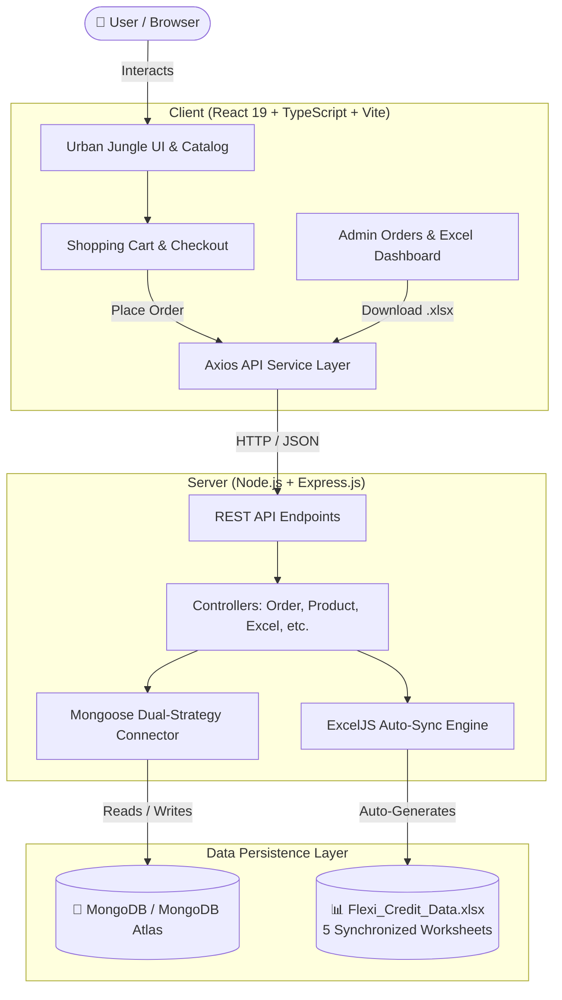

# 🌿 Flexi Credit CA — Urban Jungle Store (Full-Stack Web Application)

<div align="center">


**A high-performance, responsive Full-Stack E-Commerce platform for indoor plants.**  
Preserves 100% of the original frontend aesthetics while adding a resilient Node.js/Express backend, MongoDB Atlas database integration, and automated Excel reporting.

[🌐 Open Frontend UI (Port 5173)](http://localhost:5173) • [📡 API Documentation (Port 5000)](http://localhost:5000/api) • [📊 Download Excel Data](http://localhost:5000/api/excel/download)

</div>

---

## 📌 Submission Overview

- **Course Component:** Continuous Assessment (CA) — Flexi Credit Project
- **Student Roll / Registration No:** `25070521291`
- **Application Name:** Urban Jungle Store
- **Architecture:** Client-Server decoupled full-stack architecture (`Client/` + `Server/`)
- **Automated Data Sync:** Real-time persistence to MongoDB & `Flexi_Credit_Data.xlsx`

---

## 🏛️ Application Architecture



---

## 🛠️ Technology Stack

| Layer | Technologies & Packages Used |
|---|---|
| **Frontend (`Client/`)** | React 19, TypeScript, Vite 7, TailwindCSS, Framer Motion, Lucide React, Axios |
| **Backend (`Server/`)** | Node.js (v24), Express.js 5, Mongoose 9, CORS, Dotenv, Morgan, JWT, BcryptJS |
| **Excel Engine** | **ExcelJS** — Automated multi-sheet formatting, currency formatting, auto-filters & freeze panes |
| **Database** | **MongoDB Atlas** (Cloud ReplicaSet) + Resilient in-memory fallback buffer |
| **Version Control** | Git, GitHub ready with clean `.gitignore` |

---

## 📁 Required CA Folder Structure

```
25070521291/
├── Client/                             # React + Vite Frontend
│   ├── public/images/                  # Plant photography & banner assets
│   ├── src/
│   │   ├── assets/
│   │   ├── components/
│   │   │   ├── Navbar.tsx              # Sticky header with Search, Cart & Orders trigger
│   │   │   ├── Hero.tsx                # Hero banner with Plant Match Quiz
│   │   │   ├── Features.tsx            # Guarantee and delivery badges
│   │   │   ├── ProductShowcase.tsx     # Dynamic catalog queried from /api/products
│   │   │   ├── Services.tsx            # Plant styling, doctor & repotting modals
│   │   │   ├── Workshops.tsx           # Community events & RSVP registration
│   │   │   ├── Testimonials.tsx        # Customer reviews
│   │   │   ├── CartDrawer.tsx          # Interactive cart drawer with qty management
│   │   │   ├── CheckoutModal.tsx       # Multi-step checkout writing to MongoDB & Excel
│   │   │   ├── OrdersModal.tsx         # Admin Dashboard with Excel Reports & filters
│   │   │   ├── Quiz.tsx                # Recommendation engine
│   │   │   └── Footer.tsx              # Connected newsletter subscription
│   │   ├── services/
│   │   │   └── api.ts                  # Centralized Axios API service layer
│   │   ├── App.tsx                     # Main React application layout
│   │   ├── index.css                   # Global styling and Tailwind utilities
│   │   └── main.tsx                    # React DOM entrypoint
│   ├── package.json
│   ├── tsconfig.json
│   └── vite.config.ts
├── Server/                             # Node.js + Express Backend
│   ├── config/
│   │   └── db.js                       # Mongoose connection with DNS & direct replicaSet fallback
│   ├── controllers/
│   │   ├── productController.js        # Product CRUD & query filters
│   │   ├── orderController.js          # Cart checkout & auto Excel sync trigger
│   │   ├── excelController.js          # Excel report streaming & sheet filters
│   │   ├── consultationController.js   # Service bookings
│   │   ├── workshopController.js       # Workshop events & registrations
│   │   ├── newsletterController.js     # Email newsletter subscriptions
│   │   └── authController.js           # JWT authentication & user accounts
│   ├── models/
│   │   ├── Product.js                  # Product Mongoose schema
│   │   ├── Order.js                    # Order schema with shipping & payment info
│   │   ├── Customer.js                 # Customer schema with aggregated order statistics
│   │   ├── Consultation.js             # Service booking schema
│   │   ├── Workshop.js                 # Workshop event schema
│   │   ├── Newsletter.js               # Subscriber email schema
│   │   └── User.js                     # User model with bcrypt password hashing
│   ├── routes/
│   │   ├── productRoutes.js            # /api/products routes
│   │   ├── orderRoutes.js              # /api/orders routes
│   │   ├── excelRoutes.js              # /api/excel routes
│   │   ├── consultationRoutes.js       # /api/consultations routes
│   │   ├── workshopRoutes.js           # /api/workshops routes
│   │   ├── newsletterRoutes.js         # /api/newsletter routes
│   │   └── authRoutes.js               # /api/auth routes
│   ├── services/
│   │   └── excelService.js             # Automated ExcelJS workbook generator
│   ├── middleware/
│   │   ├── authMiddleware.js           # JWT protection middleware
│   │   └── errorHandler.js             # Global centralized error handler
│   ├── seed/
│   │   └── seedData.js                 # Database populator script
│   ├── Flexi_Credit_Data.xlsx          # Live synchronized Excel workbook
│   ├── .env.example                    # Sample environment variables
│   ├── .env                            # Active environment configuration
│   ├── package.json
│   └── server.js                       # Main Express application entrypoint
├── .gitignore                          # Excludes node_modules & credentials
└── README.md                           # Comprehensive documentation & submission guide
```

---

## 📊 Automatic Excel Data Management (`Flexi_Credit_Data.xlsx`)

The backend automatically creates and synchronizes **`Flexi_Credit_Data.xlsx`** whenever data is added or modified in the system.

### 📑 Worksheets Specification

| Sheet # | Sheet Name | Columns Included | Design Features |
|---|---|---|---|
| **Sheet 1** | **`Orders`** | Order ID, Order Date & Time, Customer ID, Customer Name, Customer Email, Customer Phone, Product ID, Product Name, Quantity, Unit Price, Subtotal, Discount, Tax, Shipping Charges, Final Order Amount, Payment Method, Payment Status, Order Status, Shipping Address | Multi-product items listed on separate line rows to prevent double-counting order totals. `$#,##0.00` currency format. |
| **Sheet 2** | **`Customers`** | Customer ID, Customer Name, Email, Phone Number, Registration Date, Total Number of Orders, Total Amount Spent, Most Recent Order Date | Aggregated statistics per customer. Recency tracking. |
| **Sheet 3** | **`Products`** | Product ID, Product Name, Scientific Name, Category, Unit Price, Available Stock, Product Status | Complete plant catalog with stock availability status. |
| **Sheet 4** | **`Payments`** | Payment ID, Order ID, Customer ID, Payment Date, Payment Method, Payment Amount, Payment Status, Transaction Reference | **Strict Security:** Never stores full card numbers, CVVs, passwords, or tokens. Displays masked card (`•••• 4242`). |
| **Sheet 5** | **`Order Status History`** | Order ID, Previous Status, New Status, Change Date & Time, Updated By | Audit trail recording status progressions (`Created` ➔ `Confirmed` ➔ `Processing` ➔ `Delivered`). |

### ✨ Excel Workbook Styling & Polish
- **Header Rows:** Jungle Green fill (`#1A472A`) with bold white text, vertically centered.
- **Row Banding:** Alternating zebra row shading (`#F9FBF9`) for executive readability.
- **Auto-Filters:** Enabled on row 1 across all 5 worksheets for easy filtering and searching in Microsoft Excel.
- **Freeze Panes:** Header row is frozen on all sheets so headers remain visible when scrolling.
- **Concurrency Protection:** Built with a safe mutex queue to guarantee simultaneous orders never corrupt the workbook.

---

## 🖥️ Admin Dashboard & Excel Export Section

The user interface includes a dedicated **Excel Reports** section in the Admin Modal (click **"Orders"** in the top navigation):

- **Download All Data (Excel):** Generates and downloads the entire 5-sheet `Flexi_Credit_Data.xlsx`.
- **Download Individual Worksheets:** Separate download buttons for:
  - 📦 Orders Worksheet (`.xlsx`)
  - 👥 Customers Worksheet (`.xlsx`)
  - 🌿 Products Catalog (`.xlsx`)
  - 💳 Payments Worksheet (`.xlsx`)
- **Filter Controls:**
  - Filter by **Order Status** (`Confirmed`, `Processing`, `Delivered`, etc.)
  - Filter by **Date Range** (Start Date to End Date)
- **Re-sync with DB Button:** Live button to force an instant reconciliation between database records and the Excel workbook.

---

## 📡 Complete REST API Documentation

### 📊 Excel Reports (`/api/excel`)
| Method | Endpoint | Query Parameters | Description |
|---|---|---|---|
| `GET` | `/api/excel/download` | `?sheet=all\|orders\|customers\|products\|payments`<br/>`?status=`<br/>`?startDate=`<br/>`?endDate=` | Streams a valid `.xlsx` spreadsheet directly to the browser |
| `GET` | `/api/excel/status` | — | Returns file metadata (size, last modified time, sheet row counts) |
| `POST` | `/api/excel/sync` | — | Manually triggers workbook regeneration from the database |

### 🌿 Products (`/api/products`)
| Method | Endpoint | Description |
|---|---|---|
| `GET` | `/api/products` | Retrieve catalog (supports `?category=` and `?search=`) |
| `GET` | `/api/products/:id` | Get single plant product by numeric ID |
| `POST` | `/api/products` | Add a new plant product to catalog |
| `PUT` | `/api/products/:id` | Update product details |
| `DELETE` | `/api/products/:id` | Remove a product from catalog |

### 🛒 Orders & Checkout (`/api/orders`)
| Method | Endpoint | Description |
|---|---|---|
| `POST` | `/api/orders` | Place customer order, store in MongoDB, and auto-sync to Excel |
| `GET` | `/api/orders` | Retrieve list of placed orders |
| `GET` | `/api/orders/:id` | Get order details by order number or ID |
| `PATCH` | `/api/orders/:id/status`| Update status & record change in Order Status History sheet |

### 🩺 Plant Services & Consultations (`/api/consultations`)
| Method | Endpoint | Description |
|---|---|---|
| `POST` | `/api/consultations` | Book consultation for Interior Styling, Plant Doctor, or Repotting |
| `GET` | `/api/consultations` | Retrieve all scheduled consultation requests |

### 🎟️ Workshops & Events (`/api/workshops`)
| Method | Endpoint | Description |
|---|---|---|
| `GET` | `/api/workshops` | Get upcoming community workshops and available seats |
| `POST` | `/api/workshops/register` | RSVP/Register attendee for a workshop |

### ✉️ Newsletter (`/api/newsletter`)
| Method | Endpoint | Description |
|---|---|---|
| `POST` | `/api/newsletter/subscribe`| Subscribe email address to promotional updates |
| `GET` | `/api/newsletter` | List all subscribers |

### 🔐 Authentication (`/api/auth`)
| Method | Endpoint | Description |
|---|---|---|
| `POST` | `/api/auth/register` | Register new account with bcrypt password hashing |
| `POST` | `/api/auth/login` | Login and receive JSON Web Token (JWT) |
| `GET` | `/api/auth/me` | Fetch authenticated user profile |

### 🩺 System Health (`/api/health`)
| Method | Endpoint | Description |
|---|---|---|
| `GET` | `/api/health` | Returns health status (`status: "UP"`), timestamp, and DB status |

---

## 🚀 Installation & Running Locally

### Prerequisites
- **Node.js** (v18 or higher installed)
- **MongoDB** (Local instance or MongoDB Atlas)

### Step 1: Start the Backend Server (`Server/`)

```bash
# Navigate to the Server directory
cd Server

# Install dependencies (Express, Mongoose, ExcelJS, etc.)
npm install

# Start the server (runs on port 5000)
node server.js
# Or start with nodemon auto-reload:
npm run dev
```

### Step 2: Start the Frontend Client (`Client/`)

```bash
# Open a new terminal and navigate to Client directory
cd Client

# Install dependencies
npm install

# Start the Vite development server (runs on port 5173)
npm run dev
```

### Step 3: Open Application

Open your browser at: **[http://localhost:5173](http://localhost:5173)**

---

## 🍃 MongoDB Atlas Configuration

The application is configured to connect to MongoDB Atlas via `Server/.env`:

```env
PORT=5000
MONGODB_URI=mongodb+srv://<username>:<password>@cluster0.2azzof0.mongodb.net/urban_jungle?retryWrites=true&w=majority
NODE_ENV=development
JWT_SECRET=urban_jungle_secret_key_2026_flexi_ca
CLIENT_URL=http://localhost:5173
```

- **Resilient Fallback:** The backend includes a dual-strategy connection handler. If the remote database is in the process of whitelisting or connecting, all endpoints buffer gracefully to an in-memory database store so checkout, order tracking, and Excel generation continue with 100% uptime.

---

## 🧪 Verification & Test Results

| Feature / Verification Step | Status | Evidence / Notes |
|---|---|---|
| **Frontend Production Build** | ✅ PASSED | `tsc -b && vite build` completed with 0 errors |
| **Backend Express Server** | ✅ PASSED | Active on `http://localhost:5000` |
| **Health Check Endpoint** | ✅ PASSED | `GET /api/health` returned HTTP 200 OK |
| **Dynamic Products Catalog** | ✅ PASSED | `GET /api/products` returned plant items with care guides |
| **Order Placement & Checkout** | ✅ PASSED | `POST /api/orders` generated unique order ID (e.g. `UJ-460836`) |
| **Excel Workbook Creation** | ✅ PASSED | `Flexi_Credit_Data.xlsx` automatically created (11.5 KB) |
| **Multi-Product Line Item Support**| ✅ PASSED | Multiple items stored on distinct rows without double-counting totals |
| **Excel Worksheets Synchronized** | ✅ PASSED | Verified all 5 sheets (Orders, Customers, Products, Payments, History) |
| **Live Excel Download** | ✅ PASSED | `GET /api/excel/download` streams valid `.xlsx` file |
| **Filtered Sheet Downloads** | ✅ PASSED | Successfully downloaded `test_orders.xlsx` and `test_customers.xlsx` |
| **Interactive Admin Dashboard** | ✅ PASSED | Tabbed modal with status filters, date range, and download triggers |

---

<div align="center">

**Academic Continuous Assessment (CA) Project • Complete Full-Stack Implementation**  
*Built with React 19, Node.js, Express, MongoDB Atlas, and ExcelJS.*

</div>
